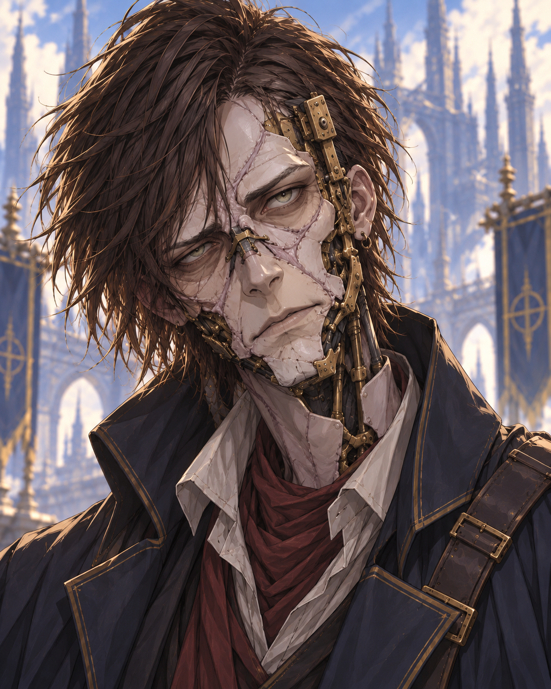

# Identity

**Elias** is a player character in [The Citizens](../factions/the-citizens.md).[^s003-roster]

# Session 2 — before the Drifters

Elias travels under Haskel’s supervision after release from the Fall. The ban on inventing and tinkering prevents him from modifying Whipperwill’s chain reactor. He advises the young inventors on their unstable material, then redirects it during the platform crisis despite glass cutting his hands. The GM says this also averts a much larger thermal catastrophe. Dayne offers him a teaching position subject to Court arrangements; Elias advocates for the children’s places. He later explains magic and science to Koris. His Corvallis materials remain sealed aboard the ship for eventual destruction; they are not destroyed in this session.[^s002-ship][^s002-rescue][^s002-offer][^s002-departure]

[Citizens-only Session 2](../sessions/session-002-citizens.md).

# Adventures

Elias helps get children below, activates a blue-glowing feline construct using his clockwork hand, and attempts to reroute the damaged engine for a time jump. The engine lacked sufficient power, forcing a fallback teleportation. The feline construct is distinct from Koris’s Swamp Poppy. Device names remain provisional.[^s003]

# Shared transition

The combined group experiences narrated death and continued awareness as objects in a cosmic state. It remains unclear this character’s exact object form or a return to a living body.[^s003]

[Session 3](../sessions/session-003-combined.md), roster.

# Proposed return from the cosmic state

Elias appeared knowledgeable about this place and proposed three requirements for return to the material plane or a resurrection-capable state: **elemental mass, speed and focus**. This is his theory, not an established law.[^s003-gap-recollection]

Everyone contributes pieces of themselves; Elias begins shaping the contributions and inscribing runes into the focus/foci. Whether these are literally pieces of souls remains questioned. The plan calls for whale-towed speed using the ship remains and spellcasters providing fire, water, lightning and earth. No successful return or resurrection is reported.[^s003-gap-recollection]

[Return plan](../quests/return-from-cosmic-state.md).

# Session 4 development

Elias perfects the focus throughout the chase and holds the trigger for all four elements. He accepts a permanent change of his overdrive explosion from fire to lightning to supply the final element, then activates a successful physical return. Adults receive temporary victus amalgams rather than their original bodies. His form mixes bleeding flesh with gears, including a central gear missing three teeth. His focus-related glimpse of coffin-like cylinders, large crops and an unnamed rakshasa supplies a body-recovery lead.[^s004]

[Combined Session 4](../sessions/session-004-combined.md).

[^s003-roster]: User roster/date note, lines 3–6.

[^s003]: Generated transcript lines 1653–1707, 2797–2833, 4329–4413; shared transition 4415–4573; gap 4975.

[^s003-gap-recollection]: User retrospective gap note, line 3 (Elias’s apparent knowledge and theory), lines 5–7 (mass, speed and focus), line 9 (contributions, rune crafting, whale/ship plan and fire, water, lightning, earth), line 11 (scope). This is recollection, not recovered audio or transcript.

[^s004]: Supplied transcript, original Unicode-delimited paragraphs 248–249, 633–651, 866–888, 953–957, 1075–1086. No independently verified audio timestamp or speaker alignment.

# Session 5 — the limits of creation

Elias’s badly damaged robotic feline returns from the bushes. He identifies himself as a former prisoner of [the Fall](../lore/the-fall.md), with a continuing ban on inventing new creations. He may repair, maintain and use existing things. The late clarification permits reproducing existing designs, including an already-invented explosive. No explosive is made or used. A legal assessment suggests astral magic may be treated differently from ordinary construction; no new sentence is imposed. His fuller name is too garbled to establish its spelling.[^s005]

[Session 5](../sessions/session-005-combined.md).

[^s005]: Original recording, 00:14:15–00:18:30; 00:35:00–00:43:30; 00:55:00–00:57:10; 04:00:00–04:04:00. Local machine transcription; no independent audio listening or speaker diarization.

# Session 6 — preparations before dawn

Elias proposes the two-team plan and modifies existing theatrical effects into a larger diversion with Cole’s help. He describes it as copying known work, but the GM says the modification could count against his continuing invention restriction. Haskel permits him to proceed after a private conversation about ambition and doing good; this does not clear him legally. Elias later intends to imitate the coffin-opening symbol after watching Haskel, but has not done so. His damaged mechanical feline is considered as a possible carrier, not shown transporting a coffin.[^s006]

[Session 6](../sessions/session-006-combined.md).

[^s006]: Original recording, 00:58:30–01:01:00; 01:16:00–01:29:59; 01:39:00–01:43:00; 02:04:00–02:05:00. Local machine transcript compared with supplied transcript; no independent audio listening or speaker diarization.

# Session 7 — escape and return

Elias learns the coffin gesture, while his restrained fireworks leave visible evidence on a critical crafting failure. He adopts the rescued mechanical lynx as his invention and commands it to tackle the remaining binder from the tower; the fall kills the binder. His knowledge check reveals that mirror shields cannot reflect gorgon petrification. He collects Dayne’s wedding-ring victus and Maren’s key, then directs the lynx to help Dayne escape. At dawn he returns as a sickly-looking, scarred man in his forties, with a full clockwork arm and dull green eyes. He works on the cart’s damaged wheel, and later considers whether giving essence during the Astral escape altered the victus objects. No answer or victus destruction follows.[^s007]

[Session 7](../sessions/session-007-combined.md).

[^s007]: Original recording, 00:12:20–00:15:20; 00:23:00–00:25:00; 01:09:00–01:13:30; 02:23:00–02:26:30; 02:39:00–02:41:30; 03:00:50–03:08:30.

# Session 8 — refuge and a shared course

Elias’s surname is given as Silverstrand, with spelling still unconfirmed. He inspects the sound forge and studies victus tracking: severance could preserve a keepsake physically while losing its magic, with emotional and legal consequences. He promises not to alter anyone’s victus hastily; none is changed. He plans to restore the ship’s engine and mechanics once its hull is aligned. Repair rolls and the operational outcome are deferred. The earlier five-year Fall sentence is recalled, and he says his parents did not share it.[^s008-yt]

[Session 8](../sessions/session-008-combined.md).

[^s008-p1]: Original Part 1 recording; Part1 00:24–00:25; Part2 00:18–00:20; 00:31–00:42; 01:58–02:00; 03:14–03:17; supplied P18,57–58,68–77,195–197,299–302.

[^s008-p2]: Original Part 2 recording; Part1 00:24–00:25; Part2 00:18–00:20; 00:31–00:42; 01:58–02:00; 03:14–03:17; supplied P18,57–58,68–77,195–197,299–302.

[^s008-yt]: Supplied YouTube transcript; Part1 00:24–00:25; Part2 00:18–00:20; 00:31–00:42; 01:58–02:00; 03:14–03:17; supplied P18,57–58,68–77,195–197,299–302.

[^s002-ship]: Original Session 2 recording, 00:18–00:31; 02:31–02:35. Local machine transcription; no independent listening or diarization. Historical events precede Session 3.

[^s002-rescue]: Original Session 2 recording, 01:20–01:45; 02:25–02:27. Local machine transcription; no independent listening or diarization. Historical events precede Session 3.

[^s002-offer]: Original Session 2 recording, 02:25–02:32. Local machine transcription; no independent listening or diarization. Historical events precede Session 3.

[^s002-departure]: Original Session 2 recording, 02:31–02:45:18. Local machine transcription; no independent listening or diarization. Historical events precede Session 3.
