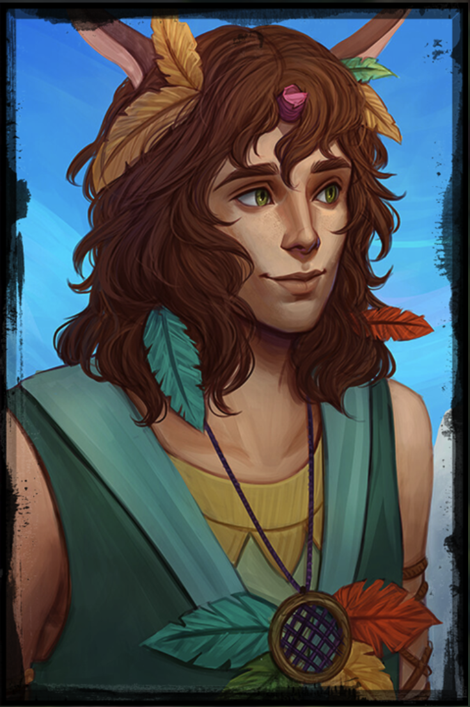

[^s009-follows-portrait]

# A roadside trader

Follows Interesting Smells is an outgoing firbolg who travels with [Sleeps Under Leaves](sleeps-under-leaves.md). He has a broken or cut horn and decorates himself with colorful leaves. Their relationship beyond traveling together is not established. They live in Alora and are returning from Lastings with horned animals in cages.[^s009-trade]

Cole meets them while looking for building supplies or food. They offer neither, but give him a partly used roll of Quick Seal Tape when he takes responsibility for three Toskers. Follows insists that the animals be fed and cared for. No trade mission into Alora follows.[^s009-trade]

[^s009-trade]: Original Session 9 recording, 00:41–01:09. Local machine transcription and selected video review; no independent listening or speaker diarization.

[^s009-follows-portrait]: User-supplied, explicitly identified image, November 9, 2026; original filename “Follows Interesting Smells.png”. Illustration is a visual reference; the session’s narrated events and mechanics remain separately sourced.
