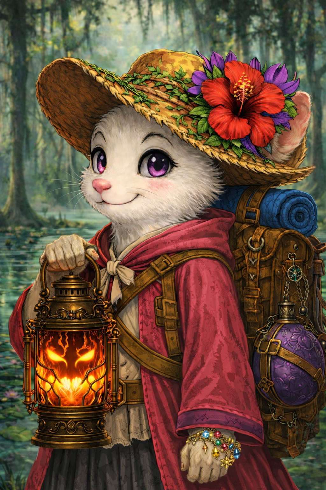

# Identity

**Koris** is a player character in [The Citizens](../factions/the-citizens.md).[^s003-roster]

# Session 2 — before the Drifters

Koris arrives in Lastings from Ti’Swa seeking Glass Needle admission, bringing tuition, family keepsakes, cursed objects and Poppy. She gives some of her visitor time to a boy, then receives a week from Dayne. Poppy bites Ustalav during the struggle over the invention. Koris later takes temporary custody of the white-haired child’s heat-draining snow globe and promises to return it, bearing the cold herself. She joins the school-bound voyage. This is her collection before the later wreck, not a restoration of her missing possessions in Session 8.[^s002-arrival][^s002-rescue][^s002-globe][^s002-departure]

[Citizens-only Session 2](../sessions/session-002-citizens.md).

# Adventures

Koris calls forth the crocodilian companion Swamp Poppy to protect the children. It attacks Cole despite instructions to avoid hurting people. She crosses back toward the children with help from Maren’s wind, reassures them about their victus objects, and accompanies them across the gap after they grow wings. Ancestry and the mechanism behind the companion are unresolved.[^s003]

# Shared transition

The combined group experiences narrated death and continued awareness as objects in a cosmic state. It remains unclear this character’s exact object form or a return to a living body.[^s003]

[Session 3](../sessions/session-003-combined.md), roster.

# Session 4 development

Koris remanifests Swamp Poppy and later uses stillness magic to slow meteors and avert immediate moon collision. The GM explicitly spells Ti’Swa and describes her upbringing where time does not pass. Her remanifested body is a yellow, floral-stitched fabric doll with a hat and difficult movement/strength in the narrative. She searches for her bags and eidolon, expresses anger at the Drifters, and says her Glass Needle plans are ruined. Exact inventory recovery and the garbled object of her intended study remain unresolved.[^s004]

[Combined Session 4](../sessions/session-004-combined.md).

[^s003-roster]: User roster/date note, lines 3–6.

[^s003]: Generated transcript lines 1057–1365, 3581–3977, 4093–4239; shared transition 4415–4573; gap 4975.

[^s004]: Supplied transcript, original Unicode-delimited paragraphs 123–184, 847–865, 923–929, 971–977, 1009–1053. No independently verified audio timestamp or speaker alignment.

# Session 5 — the blade and missing belongings

Koris recovers her enchanted satchel intact but emptied; the telescope, tuition money and mother’s handkerchief/victus are missing. She hides tracks during travel, senses blood and the cursed blade at the forge, and recruits Haskel to investigate. She wraps the blade without direct contact and gives it to him because her temporary body cannot carry it. She initially favors surrender to the Court, then reconsiders to learn whether her other cursed objects remain recoverable. The choice does not settle their fate.[^s005]

[Session 5](../sessions/session-005-combined.md).

[^s005]: Original recording, 00:10:26–00:20:20; 00:30:20–00:31:10; 01:53:00–01:58:00; 02:12:00–02:40:30; 04:05:00–04:13:30. Local machine transcription; no independent audio listening or speaker diarization.

# Session 6 — preparations before dawn

Koris accompanies Maren, Emeric and Therica to the theater tent and is entrusted with the prepared diversion device. Her enchanted backpack is not an extradimensional space large enough to store the group’s bodies. Apherion proposes testing whether her crocodile-like form returns after death; Emeric explicitly rejects it. No experiment occurs. The later recovery discussion makes collecting the Citizens’ victus objects a requirement, not optional loot.[^s006]

[Session 6](../sessions/session-006-combined.md).

[^s006]: Original recording, 00:31:00–00:38:00; 01:06:00–01:10:30; 01:18:00–01:21:59; 02:25:00–02:27:00. Local machine transcript compared with supplied transcript; no independent audio listening or speaker diarization.

# Session 7 — escape and return

Koris lends the cursed blade to Cole while insisting it remains in her charge. She handles the pyrotechnic diversion, and Swamp Poppy nonlethally subdues the shield guard. Poppy later attacks the general and dismisses as the gorgon petrifies his leg. Koris retrieves Dayne’s pocket watch and selected belongings while leaving her tuition money; her mother’s handkerchief is accounted for in her box. At dawn she returns as a small white-furred traveler with lavender eyes, pink nose and a decorated straw-hat victus with a large red flower and woven vines. Destruction of her victus is debated but does not happen.[^s007]

[Session 7](../sessions/session-007-combined.md).

[^s007]: Original recording, 00:05:40–00:09:40; 00:23:00–00:26:00; 01:13:50–01:20:30; 01:49:00–01:53:00; 02:28:00–02:31:40; 02:55:00–02:57:20; 03:04:00–03:06:50.

# Session 8 — refuge and a shared course

Koris’s foraging supplies food for five, supplemented by the old sausages so Dayne can feed the party. She aids Emeric’s tea preparation and takes a quiet moment checking her recovered cursed objects. The GM recap reaffirms that her fifty gold pieces of tuition are lost; her academic plans remain uncertain. She asks for a snow globe at the wreck, then joins the others, but none is recovered. She suggests a cursed object might assist Haskel with concealment; no disguise plan is executed.[^s008-yt]

[Session 8](../sessions/session-008-combined.md).

[^s008-p1]: Original Part 1 recording; Part1 00:31–00:38; Part2 00:48–00:55; 01:07–01:12; 01:24–01:27; 03:12–03:14; supplied P18–26,83–89,105–109,142–146,292–295.

[^s008-p2]: Original Part 2 recording; Part1 00:31–00:38; Part2 00:48–00:55; 01:07–01:12; 01:24–01:27; 03:12–03:14; supplied P18–26,83–89,105–109,142–146,292–295.

[^s008-yt]: Supplied YouTube transcript; Part1 00:31–00:38; Part2 00:48–00:55; 01:07–01:12; 01:24–01:27; 03:12–03:14; supplied P18–26,83–89,105–109,142–146,292–295.

[^s002-arrival]: Original Session 2 recording, 00:07–00:18; 00:50–00:56. Local machine transcription; no independent listening or diarization. Historical events precede Session 3.

[^s002-rescue]: Original Session 2 recording, 01:20–01:45; 02:25–02:27. Local machine transcription; no independent listening or diarization. Historical events precede Session 3.

[^s002-globe]: Original Session 2 recording, 02:02–02:15; 02:35–02:40. Local machine transcription; no independent listening or diarization. Historical events precede Session 3.

[^s002-departure]: Original Session 2 recording, 02:31–02:45:18. Local machine transcription; no independent listening or diarization. Historical events precede Session 3.

# Session 9 — repairs and Rustwater Mine

Koris helps around the repair effort and chooses to stay above with Cole’s three Toskers, hoping to learn their names and what they eat. She does not accompany the deeper mine scouting. No new recovery of her snow globe, tuition or other missing belongings is established.[^s009-trade][^s009-supplies]

[Session 9](../sessions/session-009-combined.md).

[^s009-trade]: Original Session 9 recording, 00:41–01:09. Local machine transcription and selected video review; no independent listening or speaker diarization.

[^s009-supplies]: Original Session 9 recording, 01:20–01:41. Local machine transcription and selected video review; no independent listening or speaker diarization.
