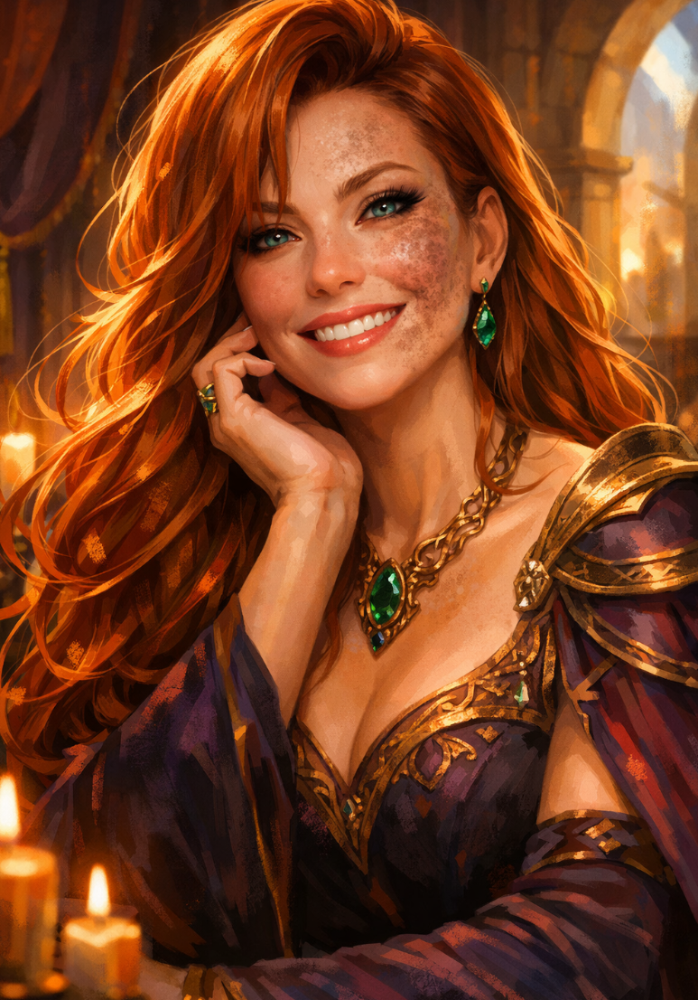

# Therica Ashtongue

Therica is the daughter of **Iolas Ashtongue IV**, Highhelm’s former king. She is an **NPC** who accompanies the adventurers, rather than a member of the player-character roster.[^therica-dictation][^primer][^therica-role]

## Cold-iron affliction

Therica suffers a curse resembling a severe allergy to **cold iron or wrought metal**, with portions of her face taking on a grayscale appearance. The affliction has been compared to Fae and to a similar condition in Campaign 1. Its cause, exact effects and relationship to those other conditions remain unknown.[^therica-dictation][^sea-dictation]

## The airship investigation

After the [sun shattered and reformed](../events/sun-shattering.md), Therica summoned the party and recounted Dochas Ùr’s relationship with the [Court of Conscience](../factions/court-of-conscience.md). She proposed traveling to Lastings in Eok to borrow, buy or otherwise obtain an airship. Rios lacks that technology; she believes an airship could help them investigate the falling object and any threat it poses to their homeland or the world.[^therica-dictation][^airship-dictation]

Accounts of the Pillars flying unusually high led Therica to suspect that the world’s sky or ceiling might be reachable by airship. No such boundary has yet been established.[^airship-dictation]

## Joining the voyage

The party accepted her mission, and Emeric persuaded her to join them. Therica feared that House Glaren would seek power in Dochas Ùr during their absence and might rule by the time they returned. That remains her prediction, rather than a confirmed takeover. Sygar, one of the original Pillars, was an ostracized son of the House who renounced his family.[^departure-dictation]

## The cosmic passage and return

Therica helped secure the chain to the steering mast while Cole boarded the astral whale. During the return, an articulated wooden woman appeared, likely Therica, though her identity and relationship to the earlier clay figure remain uncertain. Therica was later seen searching the wreck.[^s004]

[Session 1](../sessions/2026-09-28-drifters-s001.md) · [Session 4](../sessions/session-004-combined.md) · [Airship investigation](../quests/airship-investigation.md)

[^primer]: Preserved Drifters primer, PDF page 5, “The Forbidden Island,” names the slain then-king Iolas Ashtongue IV.

[^therica-dictation]: User retrospective dictation, heading “public fear and Therica summons”: paragraph 1 (fear and twenty-year context), paragraph 2 (Therica, parentage and condition), paragraph 3 (Court history and proposed journey).

[^airship-dictation]: User retrospective dictation, heading “Therica airship request”: paragraph 1 (Pillars and high-flight accounts), paragraph 2 (technology, destination and request), paragraph 3 (dictation workflow instruction), paragraph 4 (investigation goal).

[^departure-dictation]: User retrospective note, heading “acceptance, companions and departure briefing”: paragraphs 1–3 (acceptance, persuasion and political concern), paragraph 4 (research, captain and Saga), paragraph 5 (departure and incomplete precept briefing).

[^sea-dictation]: User retrospective note, heading “sea journey, Howl crossing and Eok testimony”: paragraphs 1–2 (captain, affliction and Titans), 3–4 (Howl crossing and perceptions), 5–8 (Nathaniel’s fragmentary Eok account and within-note victus correction).

[^s004]: Supplied transcript, original Unicode-delimited paragraphs 103–107, 383–386, 785–786, 906–908, 1010. No independently verified audio timestamp or speaker alignment.

[^therica-role]: User role correction note, line 1: Therica Ashtongue is an NPC, not a PC, and is commonly voiced by the GM.

# Session 5 — forest crossing and Rios history

Therica travels in a clay/polymer action-figure-like body and requests rest after five or six hours in the forest. This description adds a later account to the earlier wooden/clay imagery without inventing a definitive material reconciliation. She discusses Rios’s history and gives Dochas Ùr’s population as **845**. She accompanies the party to Alora and joins the debate surrounding the proposed recovery.[^s005]

[Session 5](../sessions/session-005-combined.md).

[^s005]: Original recording, 01:22:00–01:24:00; 03:07:00–03:10:30; 04:11:00–04:13:30. Local machine transcription; no independent audio listening or speaker diarization.

# Session 6 — preparations before dawn

Therica joins the diversion team. At the theater tent she knocks a page unconscious with a chair and hides him beneath costumes; he is not killed. She reports from Smidgen that the town chooses its mayor by whoever can sit on a throne of bees longest. She recalls a Forged founding Pillar when the group offers refuge in Rios, while the actual state of Dochas Ùr’s leadership remains unknown. Her temporary form is also deteriorating.[^s006]

[Session 6](../sessions/session-006-combined.md).

[^s006]: Original recording, 01:02:00–01:04:00; 01:06:00–01:10:30; 02:00:00–02:02:00. Local machine transcript compared with supplied transcript; no independent audio listening or speaker diarization.

# Session 7 — escape and return

Therica first fails to interfere with the general from the stage rigging, then lassos the incoming mechanical gorgon. It lifts her away before the rope jerks its shot onto the general, partly petrifying him and sparing Dayne. She crashes onto the stage unconscious and dying; Emeric transfers five vitality to her, and she reaches the cart. At dawn she returns to her original body, described as a red-haired woman around 37 with marked skin. She urges continued flight rather than debating victus destruction at the clearing. She remains an NPC.[^s007]

[Session 7](../sessions/session-007-combined.md).

[^s007]: Original recording, 01:20:30–01:21:20; 01:53:00–01:54:00; 02:26:30–02:36:30; 02:39:00–02:40:00; 02:48:00–02:50:00; 03:05:00–03:05:30.

# Session 8 — refuge and a shared course

Therica checks for pursuit, urges the Citizens to crew the ship and argues that strength can be used to protect loved ones. She recalls her grandfather ordering runemarked stones and rock armor for the Granite Guard when she became ill, linking power with his care for her. The exact royal generation is not inferred from this recollection or used to rename her father. She offers what reward is within her power and says she would pay a price for the theft if necessary. Her confidence that their mages could defeat petrification and that Rios could break any prison is a conviction, not a demonstrated cure or enacted military promise. She remains an NPC.[^s008-yt]

[Session 8](../sessions/session-008-combined.md).

[^s008-p1]: Original Part 1 recording; Part2 00:23–00:24; 01:59–02:07; 02:23–02:27; supplied P62–64,198–213,241–250.

[^s008-p2]: Original Part 2 recording; Part2 00:23–00:24; 01:59–02:07; 02:23–02:27; supplied P62–64,198–213,241–250.

[^s008-yt]: Supplied YouTube transcript; Part2 00:23–00:24; 01:59–02:07; 02:23–02:27; supplied P62–64,198–213,241–250.
